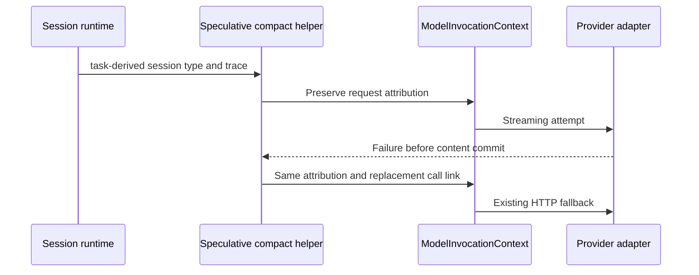

# Compact request context preservation

The session runtime owns the task type. Speculative compaction derives
`modelRequestSessionType` from that type and supplies it to the shared compact
model request helper. The helper forwards it through `ModelInvocationContext`
to the provider adapter for both the original stream and the existing HTTP
fallback. Trace attribution remains attached to the same request. The fallback
creates a replacement logical call linked to its predecessor.

Integration regression evidence is in `compact-request-context.test.ts`: the
provider-side stream and fallback observe the exact supplied session type and
trace. The helper must not erase the field merely to satisfy a typecheck.
