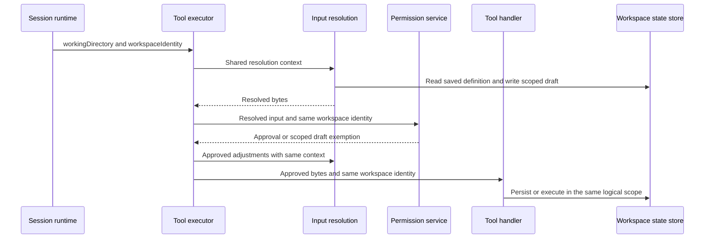

# Tool change chain

## Current execution order

The runtime owns the logical workspace identity and supplies it through
`ToolExecutorDeps`. Tool input resolution and approval adjustments share
`ToolInputResolutionContext`; they must preserve the same identity used by the
handler and permission service. The storage contract selects project state by
`workspaceIdentity?.trim() || workspacePath` and keeps it under the CCbuddy data
root. A physical working directory remains the base for ordinary file paths.

## Integration regression constraints

- `CreateWorkflow` and `SaveWorkflow` resolve project definitions using the
  session identity. Two identities at the same physical path have separate
  definitions, overwrite checks, drafts and run lookup results.
- `Edit` and `Write` are exempt from confirmation only for files under the
  current logical workspace's application-owned `workflow-drafts` directory.
  Other identities' drafts and project-local lookalike directories require the
  ordinary permission flow. Running a workflow retains its execution approval.
- Missing identity keeps the existing path fallback. Global workflow storage
  stays global.

## Required evidence

`workflow-data-paths.test.ts` covers data-root placement and scoped draft
approval. `workflow-run-identity.test.ts` covers save/find-from-run isolation.
`workflow-tool-resolution-identity.test.ts` exercises the real executor context
builder and CreateWorkflow resolution against two scoped definitions.

For a tool change, inspect its schema, resolution hook, permission decision,
approval adjustments, handler, persistence, session events and client
projection. Update the affected contracts and tests before implementation.
