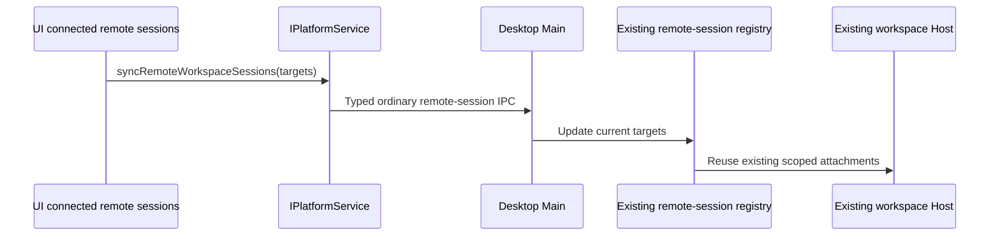

# 移除移动端远程控制

## Feature Summary

| 字段           | 决定                                                                                                                                        |
| -------------- | ------------------------------------------------------------------------------------------------------------------------------------------- |
| 用户要求       | 彻底移除移动端远程控制模块                                                                                                                  |
| Capability     | 桌面扫码配对、手机控制桌面已有 Host、手机 relay/RPC 链路                                                                                    |
| Change layer   | presentation、validation、commit-effect、persistence、recovery                                                                              |
| Operating mode | planning → implementation                                                                                                                   |
| Primary seeds  | WorkspaceWebRemoteControlTrigger、WebRemoteControlDialog、Web remote route、createWebRemoteControlManager、WebRemoteControl relay protocols |
| 当前事实       | 普通 Web 与 SSH/机器人远程会话仍使用共享 RPC、identity、owner/lease 和 replayable delivery；需按实际调用分离专用模块                        |

用户明确撤销移动端远控能力。产品不提供手机远控按钮、扫码/配对、手机控制页、
专用 OAuth/relay、远控状态/重连 API、远控持久化选项或对应开发命令。
专用实现、公开导出、依赖、测试、配置、文档及技能中的能力声明一起移除。
普通 Web 构建版本直接使用根 `package.json`，删除手机前端独立版本覆盖和比较 helper。
Bot 平台扫码登录仍使用共享二维码依赖，不属于已删除的手机控制能力。
旧手机远控 URL 使用普通未知路由处理，不再解析配对参数或建立控制连接。
不保留空实现、隐藏入口或兼容转发。

## UI Surface Matrix

| 场景                | 原入口                               | 共享实现/状态                        | 验收效果                                         |
| ------------------- | ------------------------------------ | ------------------------------------ | ------------------------------------------------ |
| 桌面打开手机远控    | Workspace trigger / dialog           | IPlatformService 与 Main manager     | 入口、二维码、状态及手机操作全部移除             |
| 手机打开远控链接    | Web route / mobile shell / task home | 专用 Web bridge、relay、controller   | 专用路由与引导页不存在，不发起配对或 relay 连接  |
| 设置和菜单          | UI 设置、侧栏、header                | AppSettings、平台能力                | 移除专用选项、事件和文案                         |
| 普通 Web            | main → direct server client          | 通用 RPC / replayable snapshot       | 普通页面、服务连接和会话能力继续通过已有契约工作 |
| 桌面 SSH/机器人会话 | Root platform workspace sync         | 现有 desktop remote-session registry | 通用目标同步使用中性命名，不依赖手机 manager     |

## Shared And Divergent Behavior

| 关注点       | 专用模块处理                                                                           | 共享边界                                                                            |
| ------------ | -------------------------------------------------------------------------------------- | ----------------------------------------------------------------------------------- |
| UI           | 删除手机 shell、task index/home、theme menu、feature provider、hooks/store/layout 分支 | 普通 Web 响应式布局、历史、Plugin UI、BYOK 使用当前服务接口                         |
| Auth/network | 删除手机配对、relay auth、QR URL、heartbeat、acknowledged relay transport              | 其它真实产品调用的普通服务连接按调用图确认                                          |
| Protocol     | 删除 WebRemoteControl 专用 payload/schema/channel/API                                  | 复用通用 RPC、workspace identity、owner/lease、CommandInbox 和 stream/snapshot      |
| Persistence  | 删除专用 settings 字段与读取/写入路径                                                  | 已有用户文件中的未知旧字段不触发迁移、连接或删除其它设置                            |
| Recovery     | 删除手机专用重连和队列实现                                                             | `desktop-continuous` 与普通 Web/SSH 使用的 `web-remote-replayable` 仍按当前契约区分 |

Topic notification 的物理计量只覆盖现存 CLI NDJSON 和 Channel/Socket 两层实际外壳，
`maxBytes` 为两者最大值。删除手机 relay 的 base64 外壳预算与返回字段，不再因已移除
链路的额外膨胀提前分片或拒绝普通 RPC 帧。真实物理上限仍约束 encoder 与 assembler；
UTF-8 分片、CRC、重组、逻辑帧原子提交及 replay/owner 语义保持当前协议。

删除只接受手机事件的 `sessionCreateTelemetrySchema` 与 `MobileSessionCreateTelemetry`
转发接口；Host 的自动化创建事件使用独立、严格的现有 Desktop schema。普通 Web 遥测
沿当前无桥契约忽略。历史行/输入中的 `inputOrigin: mobile` 等来源枚举继续可读；该字段
也由普通 Web 的通用 replayable carrier 写入，不提供控制页、配对、连接或平台 API。
本次不为历史来源元数据增加协议版本或数据迁移。
实时 `clientHello` 只接受现存 `desktop` 与 `web` 客户端类别；无调用方的
`mobileRemote` / `mobileApp` 类别移除，不能再声明已取消的移动控制客户端。

## Feature Relationships

| Rank           | 关系                                                          | 依据与处理                                                                   |
| -------------- | ------------------------------------------------------------- | ---------------------------------------------------------------------------- |
| must-inspect   | Desktop trigger → platform → Main manager → relay             | 整条手机控制路径移除                                                         |
| must-inspect   | Web route → mobile UI → client relay → shared protocol        | 删除实现与公开接口，防止仍有可调用入口                                       |
| must-inspect   | Root platform sync → Desktop remote sessions → Bot runtime    | 同步路径被手机命名污染，提取为现有通用职责                                   |
| should-inspect | settings / endpoints / package scripts / dependencies         | 清除远控专用字段、URL、命令及无调用依赖                                      |
| invariant-only | Web direct server、SSH identity/owner、历史与浏览器 lifecycle | 通过既有类型检查、针对性回归和构建验证                                       |
| evidence-only  | 本轮 CR 中新加的远控 assembly/version tests                   | 专用测试由移除验收替代，其它 provider、权限、tray 与历史测试继续验证当前能力 |

## State Owners And Commit Sinks

手机 manager、controller projection、pairing、relay queues 和手机 attachment 的专用
状态所有者及写入路径全部移除。普通远程 workspace 的目标仍由 UI 现有连接状态
派生，经 `IPlatformService.syncRemoteWorkspaceSessions` 传递到 Main 的现有 registry。
其 DTO 为 `RemoteWorkspaceSessionTarget`，从通用公开入口导出。旧手机命名的
`syncWebRemoteControlWorkspaces` API 不再存在。

同步复用 `bindRemoteWorkspaceSessionContext` 唯一写入路径，先验证真实窗口归属，
再以 `remoteSessionId`、workspacePath 和规范化 workspaceIdentity 判断重复快照。
同一归属和 scope 的重复更新不增加 generation、不重建 attachment；若前一次绑定仍等待
renderer ready ACK，重复请求等待同一个 completion，不提前返回绑定成功。失败的端口
投递可在同一 scope/generation 重试 attachment，不能误判旧 scope 的端口已经 ready。缺失或其它窗口的
session 或已关闭的 source 不接受更新。目标快照减少只停止派生同步，不主动解绑 Host 或其它窗口会话，
释放仍通过既有 dispose/window/lease 生命周期处理。

## Must-Preserve Invariants

- workspace 身份采用 `workspaceIdentity?.trim() || workspacePath`，执行和展示使用路径。
- 普通远程链路保留 `remoteSessionId`、owner/lease、stale run 防护与唯一 admission owner。
- 普通 Web 的 snapshot/replay 语义不改为桌面 continuous；仍复用现有 Host/runtime。
- 本轮 CR 的历史、BYOK、品牌、浏览器权限/关闭竞态、构建修复继续有效。
- 共享 DTO 与平台调用统一改名；不得用旧专用协议包承载通用职责。

## Codegraph Evidence

本会话没有可调用的 codegraph 工具。通过源码/import/export 搜索、受控架构 context
及引用查询覆盖深度 2 的 UI → platform/Main、Web → client/shared 调用链。
代码事实包括：`desktopRemoteSessions.attachRemoteWorkspaceSessionHost` 仍服务 Bot；
普通 server `/ws` 和 SSH `/ws` 使用 `web-remote-replayable`。

## Graph Drift Candidates / Graph Delta

移除手机专用 capability、surface、owner、service、persistence 和相关边；更新有剩余
普通 Web/SSH 调用的共享节点与 code seeds。技能文件不再宣称已删除手机模块。
部分技能引用的历史文档已经不存在，按当前源码更新引用，不恢复旧模块或旧文档。

## Clarification Log / Boundary Decisions

用户“不要移动端远程控制这个模块，彻底移除”直接授权删除全部手机专用能力。
普通 Web/SSH 的共享基础能力已由实际调用确认，统一提取/保留，无待确认产品选择。
移除验收以当前 API、产物和 UI 为准，不采用 feature flag 关闭作为完成标准。

## Dimensions / Pruning Decisions

高风险维度：Desktop/Web 表面、普通 Web/SSH 的共享调用、旧配置字段、公开入口、
开发/生产构建、当前已修复行为。手机主题/模型/工具/网络/重连组合已因整条控制路径
删除而剪枝；不为不存在的 feature 枚举运行态组合。

## Accepted Cases / Coverage

| Case             | Setup / Action                                  | Assertions / Evidence                                                |
| ---------------- | ----------------------------------------------- | -------------------------------------------------------------------- |
| REMOVE-MOBILE-01 | 读取平台公开入口与 Main/preload/renderer 接线   | 无 start/stop/status/reconnect/QR 手机 API；共享远程目标采用中性契约 |
| REMOVE-MOBILE-02 | 普通 Web 启动和直接访问旧远控路径               | 无手机页、配对参数解析或 relay 网络连接；走普通路由                  |
| REMOVE-MOBILE-03 | 桌面启动，检查菜单、header、侧栏、设置          | 无手机远控入口，正常页面可用；真实 Electron DOM 验证                 |
| REMOVE-MOBILE-04 | 普通 Web/SSH 和机器人 remote session 回归       | identity、target sync、Host 与 replay 仍使用单一现有 owner           |
| REMOVE-MOBILE-05 | 全仓专用引用、依赖、文档/技能检查               | 无产品实现或活跃指令残留；专用文件/包/开发命令不存在                 |
| REMOVE-MOBILE-06 | 标准 typecheck/lint/架构与 Desktop/Web/CLI 构建 | 执行可用验证并报告真实结果；记录已复现的既有失败                     |

## Planning Handoff / E2E Notes

Desktop、UI/Web、shared/client/services/server 分别实现；根任务清理依赖、脚本、
spec、技能图谱及最终集成验证。移除规则已固定，新增回归先红后实现。
交互验收复用本地 Electron/CDP 和 Web，使用隔离 profile 进行验证，不需要 provider
录制、Docker 或外部 relay。完成后启动当前开发实例供用户演示。

## 实际验证结果

使用 `mise.toml` 指定的 Node 24.14.0，移除已实现：

- `pnpm typecheck`、`pnpm lint`、`pnpm architecture:check --changed` 和
  `pnpm verify:pre-push` 通过；Lint 为 0 errors、54 项既有 warnings。
- 冻结依赖安装通过。二维码依赖保留给仍提供扫码登录的 Bot 平台。
- Desktop 集成回归 65/65、Shared 9/9、UI 普通启动/远程目标/历史/插件回归 9/9、
  Client sampling 1/1、CLI NDJSON transport 2/2、启动品牌/升级窗口回归 6/6 通过。
- CLI standalone 类型检查的当前 16 个任务通过；全部 16 个包的类型检查脚本也现场执行通过。
- CLI 构建与 Desktop staging、Desktop Main/Host/preload tsup、Desktop Renderer 与
  Web 生产 Vite 构建通过。真实 CLI/RPC carrier 的字节大小与新计量器一致，
  完整帧、超限 UTF-8 分片及现有物理上限回归通过。
- 历史入口 Electron 交互 E2E 通过。隔离桌面及标准开发桌面均实际渲染成功，
  无手机控制 API、入口文案或模型配置初始化错误；通用远程目标同步 API 存在。
- 生产 Web 与真实普通 server 联机成功，`/api/server-info` 和 `/ws` 可用。
  8 条旧远控路径均显示未知页面，无 WebSocket、fetch、配对或 relay 请求；
  390×844 视口的旧路径同样不建立连接，无运行时异常。
- 专用源码、导出、脚本、设置、独立前端版本 helper 和能力声明已清理；
  ignored dist 中 92 个旧专用文件也已删除。技能图谱无新增 broken edge，
  4 条已有 drift 保持原状。`git diff --check` 通过。

附加检查保留并如实记录既有失败：独立 Desktop Main `noEmit` 有 71 条已在
`origin/main` 复现的诊断，本次新增 0；CLI 全量 Lint 的既有 `debug/src/App.tsx`
max-lines 错误与基线相同。未生成最终分发安装包或执行 Windows/Linux 原生验证。

当前标准 `pnpm dev:desktop` 实例已启动并置前，供本地演示。
