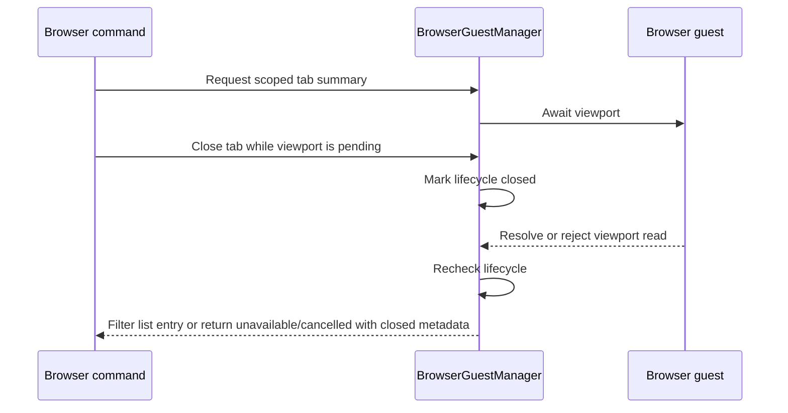
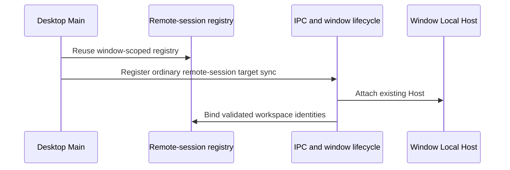
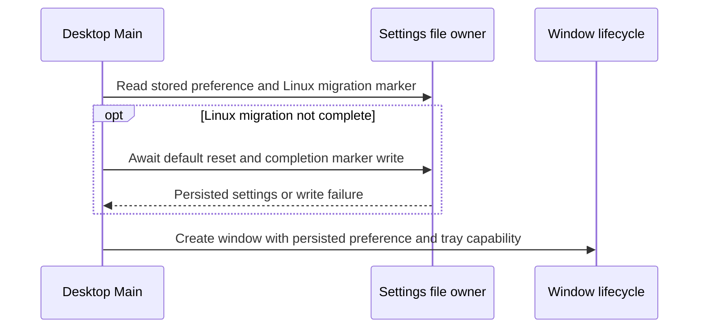
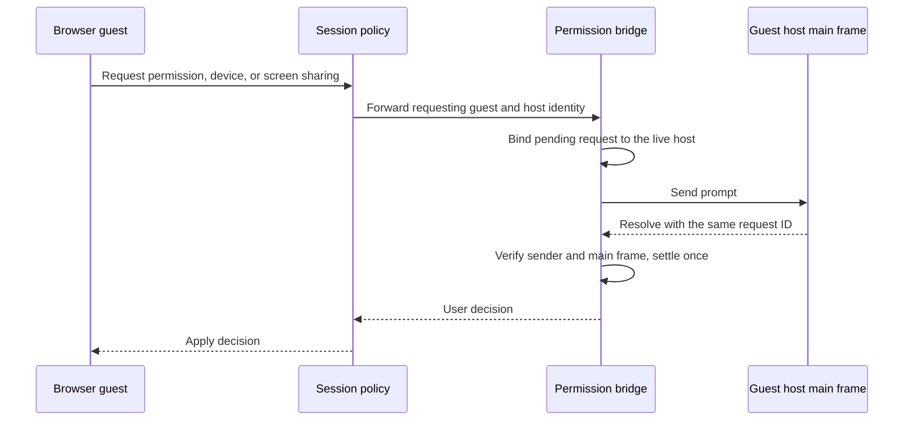
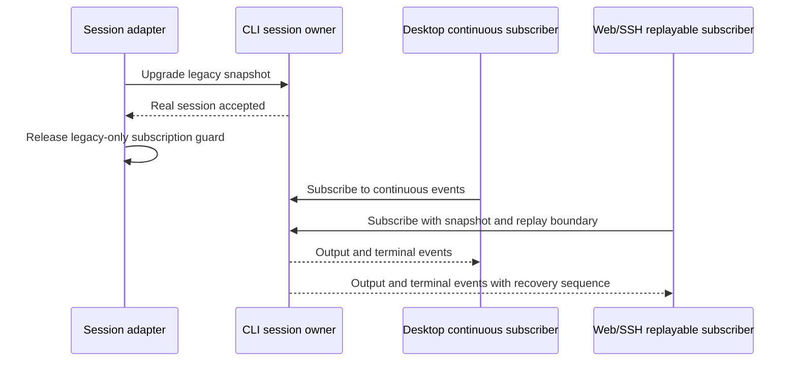

# ZCode v3.15.1 integration

## Product rules and boundaries

CCbuddy adopts the upstream runtime changes while preserving the product rules
in `byok-only.md`, `history-review.md`, `product-data-isolation.md`, and
`plugin-ui-and-gen-ui.md`. The integration must not remove CCbuddy history
navigation or reintroduce application sign-in and subscription purchase flows.

The root lockfile and package manifests describe the same installed workspace.
Build scripts must only build and stage packages present in this repository.
Desktop TypeScript project references must resolve to existing configurations;
the omitted upstream E2E project is not a dependency of a normal renderer build.
The bundled marketplace and SEA register only `visualize`, `browser-use`, and
`node-repl-host`, which are provided by the current tree. Public identifiers may
still recognize externally installed optional plugins; their absence must not
create a bundled listing, default activation, or required build input.
Desktop build configuration resolves optional telemetry and update capabilities
locally; CCbuddy updates keep the explicit CCbuddy release manifest policy.
The desktop telemetry adapter accepts the standard Fetch input forms and
serializes URL objects before crossing Electron's network API boundary.
Both development environments use the local BYOK provider template. No test
environment template may introduce account-backed models or credentials.
Main injects that same existing local template into Host in development. An
installed app reads `config/provider/ccbuddy-builtin.json` from its staged resources,
independent of environment identity; no branch requests an absent test file.
Desktop preload entries only include shipped files. Rewards pages use the
ordinary hardened browser preload; the removed account-rewards bridge cannot
remain a required build entry or be selected when attaching a web guest.

## State owners and interfaces

- Desktop Main exposes ordinary remote-session target synchronization through
  the platform service and existing window-scoped connection registry. The
  mobile-control implementation and its pairing, relay, platform APIs and
  product entry points are removed under `mobile-remote-control-removal.md`.
  Ordinary tab synchronization and Bot/SSH bindings use the existing Host.
  The manager's workspace-list producer always supplies a task array, including
  an empty array when no task is available. Its push-signature builder consumes
  that producer's precise return type. The shared wire contract may still omit
  tasks when receiving a compatible older peer's result.
- Main resolves the built-in provider configuration path when assembling the
  Local Host initialization message. Window lifecycle supplies workspace and
  runtime-environment inputs without owning the application install layout.
- The settings file owns the close-to-tray preference. On the first Linux
  upgrade, Main awaits the existing migration that resets the inherited Windows
  default and records completion before creating a window. Later launches
  respect the stored choice; failed migration writes retain the stored value
  and retry on the next launch.
- The browser site-permission store owns persisted user permission choices;
  Electron session permission handlers consume that store. Main installs the
  policy and UI bridge before creating browser guests.
  Each pending permission or device choice belongs to the requesting guest's
  live host window, and only that host's main frame can resolve it. Missing or
  destroyed hosts dismiss the request without selecting a different window.
  Screen sharing resolves the same host from Electron's requesting frame.
  Device discovery updates coalesce only for the same origin, permission, and
  native guest/frame scope; another guest gets its own chooser and callback.
- The CLI owns accepted session state. After a legacy history snapshot becomes
  a real session, the adapter must release its legacy-only subscription guard.
  Desktop continuous and ordinary Web/SSH replayable delivery subscribe to that same
  session owner and receive terminal events.
- Saved-workflow storage uses `workspaceIdentity?.trim() || workspacePath` for
  project scope. Save-from-run, overwrite checks, run lookup, and listing pass
  the same identity as ordinary workflow operations.
- Plugin UI derivation, manual pins, and retention use the existing scoped key
  built from workspace identity and session ID. Timeline producers and card
  consumers read and write the same key.
- CLI startup reads enabled plugin agent templates once with async file IO.
  Subsequent Host subagent configuration updates resolve those immutable
  templates with the latest model overrides and reserved user/project names.
  Resolution performs no file IO, preserves plugin namespaces, and cannot
  mutate templates or leak one snapshot's model choices into another.
- UI history navigation consumes the existing platform menu event and the
  existing history service contract. It does not read producer files directly.
- BrowserGuestManager remains the sole owner of browser tab lifecycle and
  scope. Tab summaries recheck that lifecycle after the asynchronous viewport
  read. Lists omit tabs closed before the list settles. Single-tab activation,
  claim, and creation return the existing unavailable or cancelled result if
  the tab closes during that read; closed lifecycle belongs only in response
  metadata, never in an open-tab summary. Existing scope, generation, guest
  ownership, and lease checks remain in force.
  Single-tab callers also recheck registry object identity, open lifecycle,
  and command scope after the summary promise settles and before returning
  success. A tab transferred to another scope cannot contribute URL or tab
  metadata to the previous command's unavailable/cancelled result.
  Closed metadata remains available after close removes the same-scope tab
  from the registry, provided that its ID has not been replaced.
  Activation also revalidates scope after guest recovery and before selecting
  a tab. Failed creation never closes a tab transferred during guest recovery,
  and unavailable/cancelled metadata is built from the current ownership.
  Each tab owns one durable-close promise. Once deletion starts, concurrent
  closes join it; commands cannot select or claim that tab, and release waits
  for the same promise. Successful deletion closes the original object before
  release can transfer it. Failed deletion preserves its guest and recovery
  data; a waiting release proceeds only if registry identity and owner still
  match. Shell and page-state writes cannot repopulate recovery during closing.
  Lists omit closing tabs, including summaries read before the close started.
  The recovery store stages mutations on a cloned snapshot and commits its
  in-memory snapshot only after the atomic file write succeeds. A failed write
  leaves both cached and persisted recovery facts unchanged for reads/retries.



```mermaid
sequenceDiagram
    participant Close as Close command
    participant Manager as BrowserGuestManager / ManagedTab
    participant Store as BrowserTabRecoveryStore
    participant Release as Release / claim / finalize
    Close->>Manager: Start durable close
    Manager->>Manager: Pin tab.closeFlight before IO
    Manager->>Store: Remove recovery shell and page state
    Release->>Manager: Request ownership change
    Manager-->>Release: Reject claim/finalize; defer lifecycle release
    alt Removal succeeds
        Store-->>Manager: Removal settled
        Manager->>Manager: Close original guest and remove registry entry
        Manager-->>Close: Resolve shared close promise
    else Removal fails
        Store-->>Manager: Removal rejected
        Manager->>Manager: Clear close barrier; preserve guest and recovery
        Manager-->>Close: Reject shared close promise
        Manager->>Manager: Recheck registry and owner, then release
    end
```









## Acceptance

1. A frozen-lockfile installation succeeds with the checked-in manifests.
2. Desktop tsup/Vite configuration loads without missing modules or named
   exports. Desktop development and production resolve a valid local provider
   template; bootstrap and runtime staging require no omitted upstream package.
3. Sidebar Sessions/Timeline and native history menu commands open the existing
   history view. Read-only producer data can still be imported into a new CCbuddy
   session through the existing explicit continue action.
4. Ordinary desktop tab/workspace synchronization and window teardown use the
   existing Host and remote-session registry. Mobile-control APIs and entry
   points are absent; repeated ordinary remote-session sync is idempotent.
5. A website permission choice affects the Electron permission decision and
   survives store reload. Permission requests with missing owners fail closed.
6. Successfully upgraded legacy history receives real session output and
   completion events through continuous and replayable subscriptions.
7. Two workspace identities sharing a physical path cannot see or overwrite
   each other's project workflows through save-from-run or find-for-run.
8. Plugin cards retain replacement, recent-turn expansion, manual pinning, and
   grouped disclosure behavior using the same scoped session key.
9. Fresh profiles expose model-service configuration, without inherited login,
   upgrade, or application subscription controls. Empty-model copy resolves in
   every shipped locale. Draft greetings and startup loading present the
   existing CCbuddy artwork in both themes. Every CSS import and bundled image
   reference resolves to a repository asset in a real Web/Desktop build.
10. Dock icon startup behavior follows the macOS rule in `product-branding.md`.
11. Closing a tab during a pending viewport read cannot produce an invalid tab
    summary or make a list fail. Activation, claim, and creation return a
    schema-valid unavailable/cancelled result, preserve request metadata, and
    never advertise the closed tab as active. A tab closed after its own read
    but before another list entry settles is also omitted.
    Closing, replacing, or transferring a tab in the microtask between summary
    completion and single-tab response rejects the stale success result.
    Transferring during guest recovery cannot select the new owner's tab or
    close it as failed creation, and cannot expose its metadata in recovery
    failures.
    During durable removal, a concurrent finalize/claim cannot transfer the
    tab; repeated closes remove recovery and guest once. A deletion failure
    permits deferred release only for the same registry object and owner.
    A shell write or snapshot finishing during removal cannot recreate its
    deleted recovery data.
    Lists omit a tab whose durable close starts during its viewport read or
    while a later list entry is still being read.
    A real recovery-file write failure leaves cached shell and page-state data
    unchanged and permits a successful retry after the file becomes writable.
